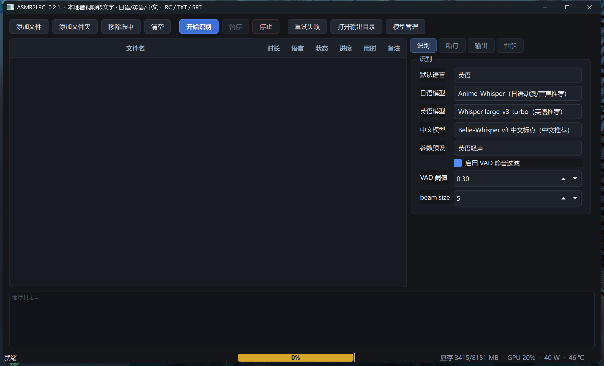

# ASMR2LRC

**把 ASMR 音声批量转成 LRC 歌词 / TXT 纯文本 / SRT 字幕的 Windows 桌面工具。**
本地运行，全程离线不上传；支持**日语、英语、中文**；专为耳语、低音量、长静音的 ASMR 场景调过参。



## 为什么不用现成的转写工具

通用转写工具直接跑 ASMR 音声，通常会遇到三个问题，这个项目就是围绕它们做的：

| 问题 | 原因 | 这里的做法 |
|---|---|---|
| 漏句、整段丢失 | 耳语音量低，默认 VAD 阈值过高直接判成静音 | 阈值可降到 0.15–0.25，配 `speech_pad` 补边 |
| 冒出不存在的句子 | Whisper 在静音/喘息段容易生成幻觉 | 日/英/中三套幻觉黑名单 + 重复行去重 + `no_speech_prob` 过滤 |
| 时间轴漂移 | 长音频里误差累积，字幕越到后面越偏 | 按停顿断句、行首对齐真实开口、强制单调与最小间隔 |

另外：**行级 LRC**（不切词），日英中**分文件**输出，可以整个文件夹拖进来批量跑。

## 功能

- **批量队列**：拖入文件或文件夹递归扫描，暂停 / 继续 / 停止、失败重试、跳过已存在、断点续跑
- **逐文件定语言**：右键单独指定日语 / 英语 / 中文 / 自动，混合批次一次跑完
- **GPU 加速**：CTranslate2 + CUDA float16，RTX 5060 8GB 实测 15 分钟音频约 25–30 秒
- **显存友好**：单模型串行加载、切换语言自动释放；可用显存不足时自动降级 int8
- **实时监控**：状态栏显示显存占用、GPU 利用率、功耗（W）、核心温度（℃）、解码速度（tok/s）
- **进度可视化**：空槽黄色 → 1–30% 白色 → 31–99% 蓝色 → 100% 全绿
- **三种输出**：LRC（仅原文）/ TXT（纯文本）/ SRT（字幕），可任意组合
- **编码可选**：UTF-8 / UTF-8 BOM / GBK / Shift-JIS（照顾老播放器）
- **输出位置**：音频同目录，或统一输出目录（可保持子目录结构）

## 环境要求

- Windows 10 / 11 x64
- NVIDIA 显卡，显存 6GB 以上（8GB 可以边跑边开浏览器）
- 显卡驱动 ≥ 570（自带 CUDA 12 运行库即可，**不需要**单独装 CUDA Toolkit、PyTorch 或 ffmpeg）
- Python 3.11+（仅从源码运行时需要）

> RTX 50 系（Blackwell / sm_120）需要 `ctranslate2 >= 4.7.1` 且使用 `float16`，int8 在旧版本会报 `CUBLAS_STATUS_NOT_SUPPORTED`。本仓库的 `requirements.txt` 已锁好可用版本。

## 快速开始（源码运行）

```bat
git clone https://github.com/miku39ovo/Local-ASMR-Speech-Recognition-CN-EN-JP.git
cd Local-ASMR-Speech-Recognition-CN-EN-JP

python -m venv .venv
.venv\Scripts\python.exe -m pip install -i https://pypi.tuna.tsinghua.edu.cn/simple -r requirements.txt

.venv\Scripts\python.exe main.py
```

启动后界面右上角进「模型管理」，按需下载模型（**模型不进仓库**，首次需自己下，总计 1.5–3GB/个）。国内默认走 `hf-mirror.com` 镜像。

## 模型

| 语言 | 模型 | 体积 | 说明 |
|---|---|---|---|
| 日语（默认） | [`anime-whisper`](https://huggingface.co/quantumcookie/anime-whisper-ct2-fp16) CT2 fp16 | 1.5 GB | 动漫/游戏语音微调，断句自然、带标点。原生时间戳异常，程序用 VAD 分段提供时间锚点 |
| 日语（备选） | [`kotoba-whisper-v2.0`](https://huggingface.co/kotoba-tech/kotoba-whisper-v2.0-faster) | 1.5 GB | 速度约 3 倍、时间戳准确，但**无标点**、断句偏长 |
| 英语（默认） | [`large-v3-turbo`](https://huggingface.co/deepdml/faster-whisper-large-v3-turbo-ct2) CT2 | 1.6 GB | 支持词级时间戳，行首时间精确；「自动检测」也用它 |
| 中文（默认） | [`Belle-whisper-large-v3-zh-punct`](https://huggingface.co/k1nto/Belle-whisper-large-v3-zh-punct-ct2) fp16 | 2.9 GB | 中文专用微调，**自带标点**、无繁体，实测字错率约 2.4% |
| 中文（快速） | [Belle turbo zh int8](https://huggingface.co/wolfofbackstreet/faster-whisper-belle-whisper-large-v3-turbo-zh-ct2-int8) | 0.8 GB | 速度约 2.3 倍、显存更低，但错字明显更多，适合先跑粗稿 |

RTX 5060 8GB 实测（15 分钟音频）：

| 模型 | 用时 | RTF | 速度 |
|---|---|---|---|
| 英语 large-v3-turbo | ~25 s | 0.04 | 138 tok/s |
| 中文 Belle 标点版 | ~70 s | 0.09 | 58 tok/s |
| 中文 Belle turbo int8 | ~30 s | 0.04 | 184 tok/s |
| 日语 anime-whisper | ~75 s | 0.28 | 33 tok/s |

> 语言必须和模型匹配。用日语模型识别中文会输出大量错字。

## 命令行

图形界面之外还有一个批量入口，适合脚本调用：

```bat
python -m app.cli "D:\audio\folder" --lang zh --formats lrc,txt --out "D:\subs"
python -m app.cli a.mp3 b.mp3 --lang ja --formats lrc --chars 26 --offset 0.2
```

| 参数 | 说明 |
|---|---|
| `--lang` | `ja` / `en` / `zh` / `auto` |
| `--formats` | 逗号分隔，`lrc,txt,srt` |
| `--out` | 输出目录，留空则与音频同目录 |
| `--chars` | 每行最多字数，0 表示按语言默认 |
| `--offset` | 整体时间偏移（秒），正数后移 |
| `--compute` | `auto` / `float16` / `int8_float16` |
| `--model-ja` / `--model-en` / `--model-zh` | 覆盖该语言使用的模型 key |

## 打包成 exe

PyInstaller **onedir**（不要用 onefile，CTranslate2 + CUDA 库解压太慢）：

```bat
.venv\Scripts\python.exe -m pip install pyinstaller
.venv\Scripts\python.exe -m PyInstaller ASMR2LRC.spec --noconfirm
```

产物在 `dist\ASMR2LRC\`，把 `models\` 放进去即可分发。整个文件夹可以整体移动到别的目录，路径变了也能跑；**不要只复制 exe**。

打包后自检（依次跑日语/中文/英语三个模型，结果写 `logs\selftest.txt`）：

```bat
ASMR2LRC.exe --selftest
```

## 参数说明

| 参数 | 默认 | 说明 |
|---|---|---|
| 每行最多字数 | 日语 28 / 英语 42 / 中文 20 | 超过就按标点切 |
| 单行最长秒数 | 8 | 长句强制拆分 |
| 时间提前 | 0.15 s | 让字幕略早于声音出现 |
| 整体偏移 | 0 | 成品整体平移，用于对齐播放器 |
| VAD 阈值 | 日语 0.25 / 中文 0.25 | 越低越能抓到耳语，但可能带入杂音 |
| 合并间隔 | 0.6 s | 相邻短句合并的间隔上限 |

## 常见问题

**时间轴整体偏早/偏晚？** 调「整体偏移」，正数后移。不同播放器渲染 LRC 的策略不同，±0.2 s 内算正常。

**显存不够？** 「性能」页选 int8 低显存模式；程序也会在可用显存不足时自动降级，且同一时刻只加载一个模型。

**首次识别很慢？** 第一次推理含 CUDA 初始化（10–20 s），之后正常。

**中文行从词中间断开？** 程序优先在标点/停顿处断行；仍不满意就把「每行最多字数」调大或调小「合并间隔」。

**出现「ご視聴ありがとうございました」这类无关行？** 已内置黑名单；若仍有残留，说明该段被判成语音，提高 VAD 阈值或换「BGM 较重」预设。

## 项目结构

```
app/
  config.py         全局设置、目录与环境变量重定向（缓存全部指向程序目录，不写 C 盘）
  cli.py            命令行入口
  core/
    engine.py       faster-whisper 封装、显存自适应、VAD 分段
    pipeline.py     单文件处理流程（探测 → 转写 → 后处理 → 写出）
    postprocess.py  幻觉过滤、断句、时间轴对齐
    formatter.py    LRC / TXT / SRT 写出
    audio.py        音频探测与解码（PyAV）
    gpu.py          显存 / 利用率 / 功耗 / 温度查询（NVML，nvidia-smi 兜底）
    cuda_dlls.py    把 nvidia pip 包里的 DLL 加入搜索路径
    models.py       模型清单与下载
  ui/               PySide6 界面（主窗口 / 表格 / 进度条 / 模型管理 / 主题）
main.py             入口（--selftest 自检）
ASMR2LRC.spec       PyInstaller 打包配置
```

约 3100 行 Python，无 PyTorch 依赖。

## 已知限制

- 无 GPU 时能跑（自动退到 CPU int8），但速度慢一个数量级
- 词级时间戳只对 turbo 系模型可靠；anime-whisper 走 VAD 分段，长句时间轴可能偏 0.2–0.5 s
- 强 BGM、多人重叠说话的场景识别率明显下降
- 仅 Windows（用了 `ctypes` 调 Win32 DLL 搜索路径与快捷方式）

## 许可与声明

代码以 [MIT](LICENSE) 许可发布。模型权重版权归各自作者所有，使用前请阅读对应 Hugging Face 仓库的许可条款。

本项目仅提供语音转文字的技术工具。请确保你处理的音频拥有合法使用权，不要用本工具传播侵犯版权的内容。
